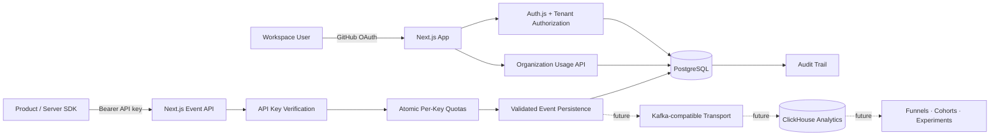
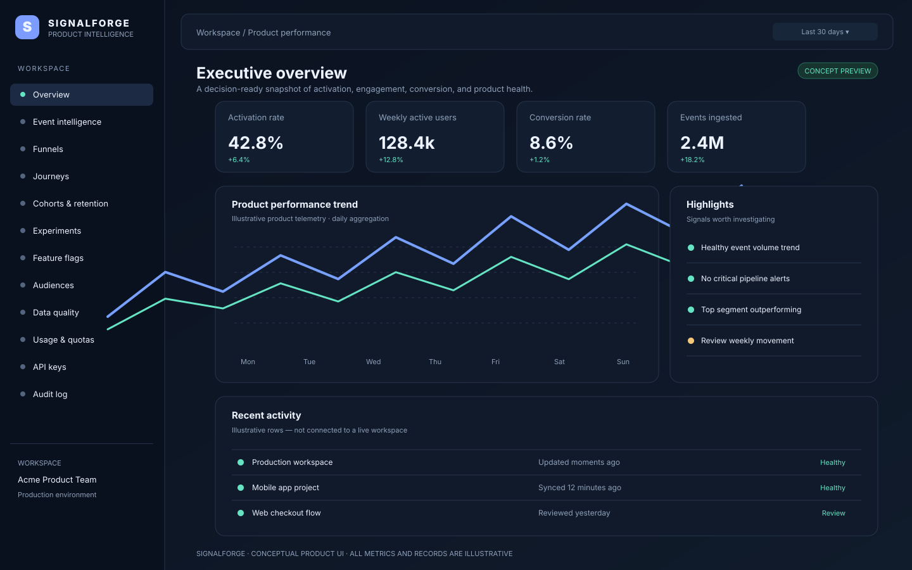
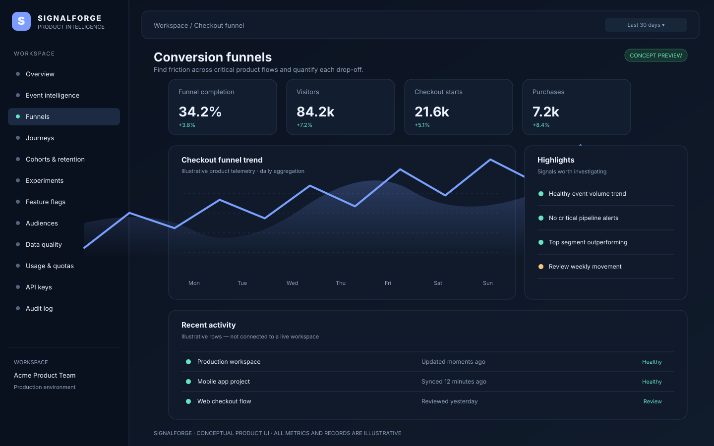
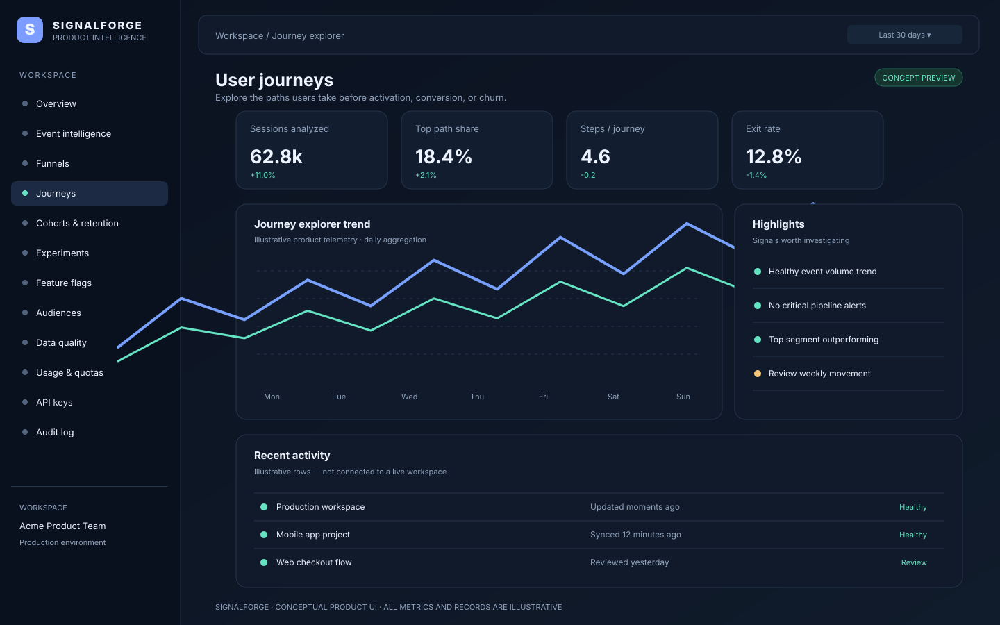
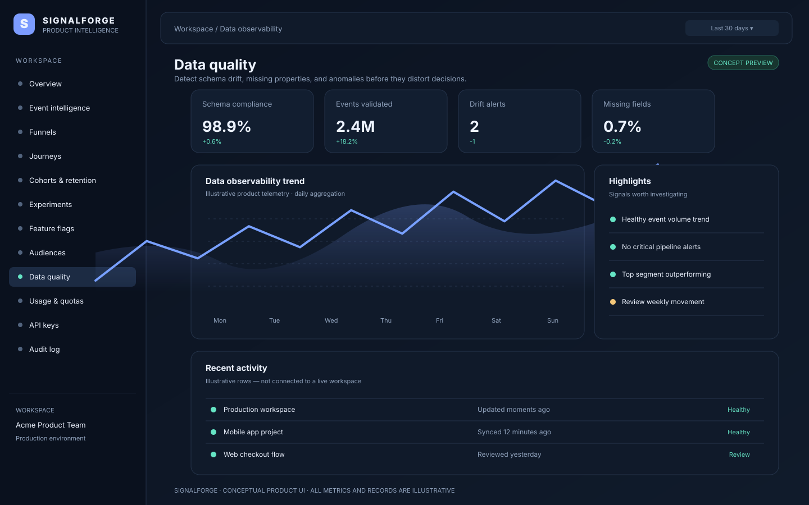
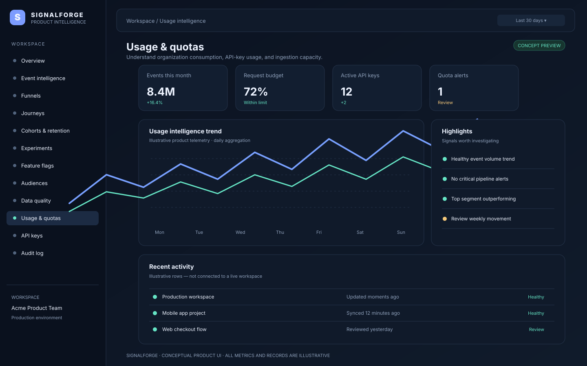
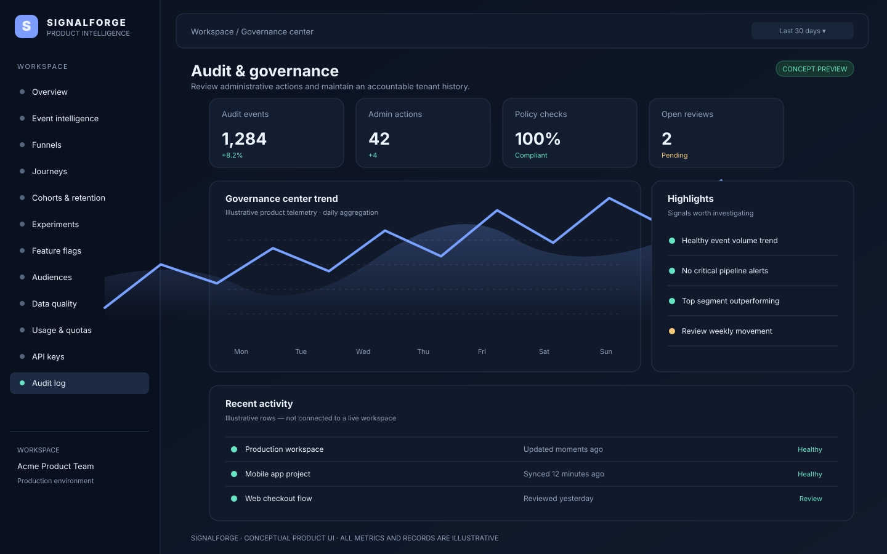

<div align="center">

# SignalForge

### Product Intelligence. Experimentation. Decisions backed by evidence.

**An enterprise-minded product analytics platform designed to turn behavioral signals into confident product decisions.**

[](https://github.com/matiur25580/SignalForge-Enterprise-Product-Intelligence-Experimentation-Platform/actions/workflows/ci.yml)


[Architecture](#architecture) · [Capabilities](#implemented-capabilities) · [Dashboard concepts](#dashboard-concepts) · [Getting started](#getting-started) · [Roadmap](#roadmap)

</div>

---

## Why SignalForge?

Product teams collect events, run experiments, and ship features—but the evidence is often scattered across disconnected tools. SignalForge is being built as a unified workspace for understanding product behavior, measuring outcomes, governing releases, and making decisions with trustworthy data.

The project emphasizes the engineering foundations behind a credible SaaS product: tenant isolation, scoped credentials, idempotent ingestion, atomic quotas, auditable actions, and automated verification.

> **Current implementation status:** The repository contains a Next.js application with authenticated workspace, organization/team and project management screens, plus backend APIs for multi-tenant identity, projects, API keys, event ingestion, per-key quotas, and organization usage reporting. The 12 dashboard images below are **conceptual product-design previews with illustrative data**, not screenshots of currently implemented live dashboard pages. Production deployment and runtime verification have not been performed.

## Implemented capabilities

| Area | Current implementation |
|---|---|
| Identity | Auth.js GitHub OAuth and database-backed sessions |
| Multi-tenancy | Organizations, memberships, roles, and server-side access checks |
| Team management | Secure email-bound invitations, member directory, role administration, guarded removal, single-use acceptance, revocation, audit trail, and interactive team UI |
| Workspace UI | Authenticated organization dashboard, workspace creation, project registry, team administration, and invitation token handling |
| Projects | Organization-scoped project creation and listing |
| API credentials | Cryptographically random secrets, SHA-256 hash-only storage, one-time display, expiry, revocation, atomic audited rotation, and interactive organization key console |
| Event ingestion | Strictly validated batch endpoint, bounded payloads, server-derived environment, and duplicate protection |
| Rate limiting | Atomic PostgreSQL per-key limits: 120 requests and 10,000 submitted events per minute |
| Usage intelligence | Authenticated organization usage report with project and API-key breakdowns, dashboard summaries, and plan entitlement visibility |
| Plan entitlements | Free, Pro, and Enterprise organization tiers with plan-specific atomic per-key ingestion quotas and a transparent plan comparison page |
| Billing visibility | Current plan, tier comparison, usage and entitlement overview; payment processing is explicitly disabled |
| Auditability | Transactional audit records for organization, project, and API-key lifecycle actions |
| Database delivery | Committed Prisma migrations applied against clean PostgreSQL in CI |
| Quality gates | Vitest, ESLint, TypeScript checks, Prisma validation, and production build in GitHub Actions |

### Team invitations

Organization OWNERs can invite teammates as ADMIN, MEMBER, or VIEWER; ADMINs can invite MEMBER or VIEWER only. Invitation tokens are generated using cryptographically secure randomness, stored only as SHA-256 hashes, expire after seven days, and can be accepted only by a signed-in account with the matching email. Members can be listed, roles can be changed under a strict OWNER/ADMIN hierarchy, and non-owner members can be removed. Acceptance, role changes, revocation, and removal are transactional and audited. The API returns the invitation token once; the team UI displays it once with a copy action. Automatic email delivery and a dedicated invitee acceptance page are not implemented yet. See [Team management](docs/TEAM-MANAGEMENT.md).

### Event ingestion contract

Send batches to `POST /api/v1/events` with a project ID and an API key:

```http
POST /api/v1/events
Authorization: Bearer sf_live_<secret>
Content-Type: application/json
```

```json
{
  "projectId": "your_project_cuid",
  "events": [
    {
      "eventId": "checkout-0001",
      "eventName": "checkout.completed",
      "timestamp": "2026-11-21T10:30:00.000Z",
      "userId": "user-123",
      "properties": {
        "currency": "INR",
        "total": 1299
      }
    }
  ]
}
```

The endpoint validates the payload, verifies API-key scope and lifecycle state, enforces per-key request/event quotas in PostgreSQL, persists events with project-scoped idempotency, and reports accepted/duplicate counts. See [Event ingestion](docs/EVENT-INGESTION.md).

### Organization usage reporting

`GET /api/organizations/:organizationId/usage` returns organization-scoped event totals and per-project/API-key breakdowns. It defaults to the trailing 30 days and accepts ISO-8601 `from` and `to` parameters for custom windows up to 90 days. Ingestion entitlements are enforced per API key using the organization’s Free, Pro, or Enterprise plan. The public `GET /api/plans` endpoint publishes the plan catalog. Organization admins can inspect API-key usage and plan entitlements in the workspace UI. The API-key console supports secure creation, one-time secret copying, metadata listing, revocation, and atomic rotation. Rotation revokes the old key and creates a replacement with preserved project scope and expiry in one audited transaction; the replacement secret is shown once. This is not payment processing or a subscription checkout system. See [API keys](docs/API-KEYS.md), [Usage metering](docs/USAGE-METERING.md), and [Subscription plans](docs/SUBSCRIPTION-PLANS.md).

## Architecture

SignalForge currently follows a modular-monolith approach for its control plane. High-volume analytical infrastructure is part of the roadmap and is not represented as already deployed.



### Engineering principles

- **Tenant isolation:** Organization ownership and membership are verified server-side; request payloads never define tenant scope.
- **Credential hygiene:** API secrets are shown once; only their SHA-256 hashes are persisted.
- **Idempotency:** Event IDs are unique within a project, preventing duplicate persistence on retries.
- **Atomic quotas:** PostgreSQL upserts reserve request and event capacity safely under concurrent traffic.
- **Transactional consistency:** Quota reservation and event persistence share a transaction.
- **Auditability:** Sensitive lifecycle operations produce organization-scoped audit records.
- **Honest observability:** Empty or unimplemented product areas are not presented as live metrics.

## Dashboard concepts

The following 12 screens illustrate the intended product experience and information architecture. They are original SVG design previews, presented in a **single vertical column** for easy review. All figures, activity rows, and chart values are illustrative; these screens are not wired to live product data.

### 01 · Executive overview
A high-level workspace snapshot for activation, engagement, conversion, and overall product health.



### 02 · Event intelligence
An operational view of event volume, accepted traffic, duplicate rates, and source health.


### 03 · Conversion funnels
A focused analysis surface for conversion steps, drop-off points, and checkout performance.



### 04 · User journeys
A journey exploration workspace for understanding common paths, key transitions, and exits.



### 05 · Cohorts & retention
A retention view for comparing acquisition cohorts and tracking long-term engagement.


### 06 · Experimentation
An experiment operations view for enrollment, outcome movement, and sample-ratio monitoring.


### 07 · Feature flags
A release governance view for flag inventory, rollout coverage, and operational safety.


### 08 · Audience cohorts
A segmentation workspace for defining behavioral audiences and understanding their size.


### 09 · Data quality
A data observability concept for schema compliance, drift alerts, and event validation.



### 10 · Usage & quotas
An organization consumption view for event volume, API-key activity, and quota awareness.



### 11 · API key security
A credential administration concept for key lifecycle, expiry hygiene, and revocation review.


### 12 · Audit & governance
An accountability view for administrative activity, policy checks, and review workflows.



## Technology stack

| Layer | Technology |
|---|---|
| Web application | Next.js 15 App Router, React 19 |
| Language | TypeScript |
| Styling | Tailwind CSS |
| Authentication | Auth.js (GitHub OAuth) |
| Operational database | PostgreSQL 16 |
| ORM and migrations | Prisma 6 |
| Validation | Zod |
| Automated tests | Vitest |
| CI | GitHub Actions |

**Planned analytical and distributed systems:** ClickHouse, Redis, Kafka/Redpanda, background workers, OpenTelemetry, and a Python-based AI service. These are roadmap items, not current runtime dependencies.

## Getting started

### Prerequisites

- Node.js 20+
- pnpm 10+
- PostgreSQL 16+
- A GitHub OAuth application

### 1. Clone the repository

```bash
git clone https://github.com/matiur25580/SignalForge-Enterprise-Product-Intelligence-Experimentation-Platform.git
cd SignalForge-Enterprise-Product-Intelligence-Experimentation-Platform
```

### 2. Configure environment variables

Copy the example file and configure your local credentials:

```bash
cp .env.example .env
```

Required values:

| Variable | Purpose |
|---|---|
| `DATABASE_URL` | PostgreSQL connection string |
| `AUTH_SECRET` | Auth.js session encryption secret |
| `AUTH_GITHUB_ID` | GitHub OAuth client ID |
| `AUTH_GITHUB_SECRET` | GitHub OAuth client secret |

Set the GitHub OAuth callback URL to:

```
http://localhost:3000/api/auth/callback/github
```

Never commit your real `.env` file or production credentials.

### 3. Install and initialize

```bash
corepack enable
pnpm install
pnpm db:generate
pnpm db:deploy
```

### 4. Run the application

```bash
pnpm dev
```

Open [http://localhost:3000](http://localhost:3000) and sign in through GitHub OAuth.

### Useful commands

```bash
pnpm dev          # Start the web application
pnpm test         # Run automated tests
pnpm lint         # Run ESLint
pnpm typecheck    # Run TypeScript checks
pnpm build        # Create a production build
pnpm db:generate  # Generate Prisma Client
pnpm db:migrate   # Create/apply a development migration
pnpm db:deploy    # Apply committed migrations
pnpm db:studio    # Open Prisma Studio
```

## Verification & delivery

GitHub Actions provisions an ephemeral PostgreSQL 16 service, generates Prisma Client, validates the Prisma schema, applies committed migrations, runs automated tests, and performs lint, typecheck, and production-build checks.

- [View CI workflow](https://github.com/matiur25580/SignalForge-Enterprise-Product-Intelligence-Experimentation-Platform/actions/workflows/ci.yml)
- [Implementation status](docs/STATUS.md)
- [Testing guide](docs/TESTING.md)

CI success verifies the checks in that workflow; it does not imply that a production environment, live customer data, or external analytical infrastructure has been configured.

## Roadmap

- [x] Multi-tenant identity, organizations, roles, and project foundations
- [x] Secure API-key lifecycle and scoped event ingestion
- [x] Atomic per-key request and event quotas
- [x] Organization-level usage reporting
- [x] Plan catalog and organization-level Free/Pro/Enterprise ingestion entitlements
- [x] Authenticated workspace dashboard, organization creation, project registry, and team management UI
- [x] Organization API-key console, usage dashboard, and read-only plan/billing overview
- [ ] Payment-backed subscription lifecycle, self-service upgrades, and billing
- [ ] API-key rotation workflow and usage threshold notifications
- [ ] Invitation email delivery and invitee acceptance UI
- [ ] Product SDKs and durable event transport
- [ ] ClickHouse-backed funnels, journeys, cohorts, and retention
- [ ] Feature flag evaluation and controlled rollouts
- [ ] Experiment assignment, sample-ratio checks, and statistical readouts
- [ ] Evidence-linked anomaly detection and AI-assisted product analysis
- [ ] Operational observability, integrations, and governance workflows

## Documentation

- [Database migrations](docs/DATABASE.md)
- [Identity and organization APIs](docs/IDENTITY.md)
- [Team management and invitations](docs/TEAM-MANAGEMENT.md)
- [Security baseline](docs/SECURITY.md)
- [API key lifecycle](docs/API-KEYS.md)
- [Event ingestion contract](docs/EVENT-INGESTION.md)
- [Usage metering](docs/USAGE-METERING.md)
- [Subscription plans](docs/SUBSCRIPTION-PLANS.md)
- [Automated testing](docs/TESTING.md)
- [Implementation status](docs/STATUS.md)

## Contributing

Issues and focused pull requests are welcome. For substantial changes, please open an issue first to discuss the proposed design. Keep changes scoped, add tests for behavior changes, and update documentation when contracts change.

## License

No license has been selected yet. Until a license is added, the repository should not be treated as granting general permission to reuse, distribute, or modify its contents.

---

<div align="center">

**SignalForge** · Evidence first. Product decisions with confidence.

</div>
